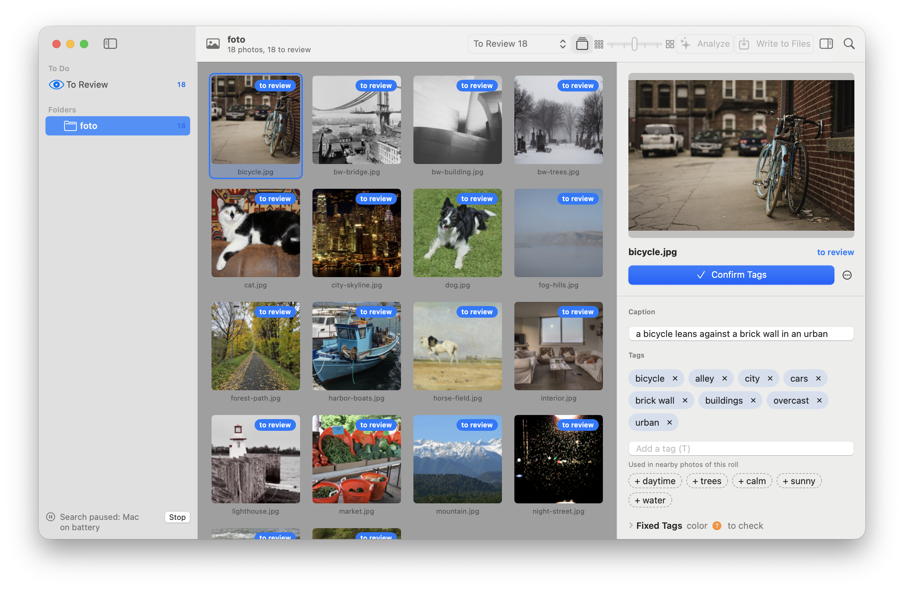
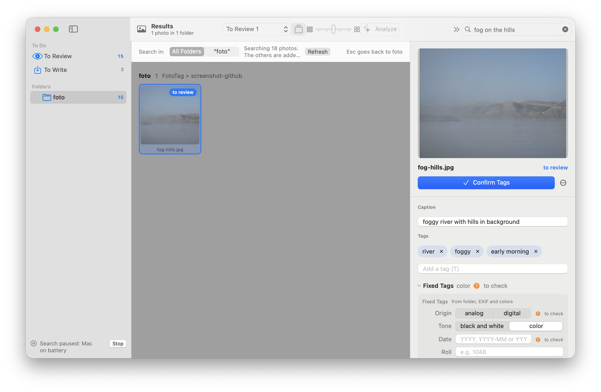
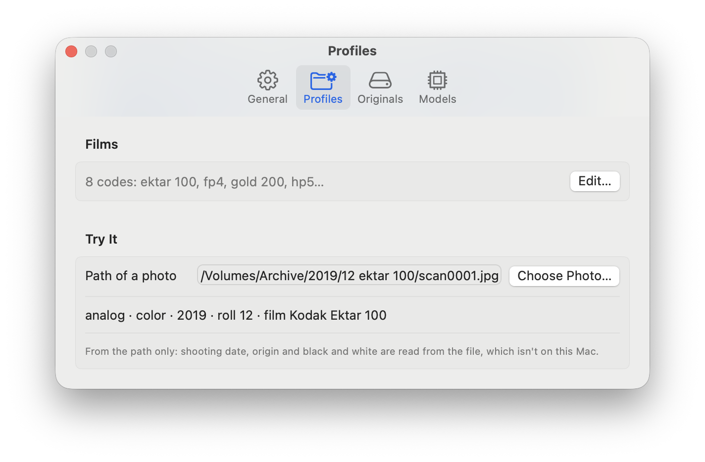

# FotoTag

[English](README.md) · **Italiano**

**Tag e didascalie per le tue foto, scritti dal tuo Mac. Le foto non escono mai dal computer.**

FotoTag guarda le foto di un archivio, propone tag e una didascalia in italiano, te li fa controllare e li scrive nei file (o nel `.xmp` accanto ai RAW). Poi puoi cercare le foto a parole: «bambini al mare», «nebbia in collina», «bicicletta sotto la pioggia».

È pensata per fotografi con archivi grandi, anche di scansioni di pellicola, su dischi esterni o in cloud.



| Ricerca a parole | I profili leggono le cartelle |
|---|---|
|  |  |

## Cosa fa

- **Analizza in locale** con un modello visione-linguaggio (Qwen3-VL, eseguito con [MLX](https://github.com/ml-explore/mlx-swift) sul chip Apple). Nessun servizio in rete, nessun abbonamento.
- **Ti lascia l'ultima parola**: le proposte restano in **Da rivedere** finché non le confermi.
- **Scrive nei file senza ricomprimere** le immagini, con una copia di sicurezza di ogni file toccato. I RAW non si toccano mai: i tag vanno nel `.xmp` accanto.
- **Cerca a parole** con un secondo modello (SigLIP 2), anche fra foto che non hai ancora taggato.
- **Capisce le tue cartelle** con i profili: anno/mese/rullino, nomi da ignorare, sigle delle pellicole («hp5» → «Ilford HP5 Plus 400»).

## Cosa serve

- Un Mac con chip Apple (M1 o successivi) e macOS 14 Sonoma o successivo.
- 16 GB di memoria per il modello normale (Qwen3-VL 8B, 5,8 GB da scaricare); con 8 GB FotoTag usa il modello leggero (4B, 3,1 GB), più veloce ma meno preciso.
- Circa 20 GB liberi: 5 GB per compilare, 5,8 per il modello di analisi (3,1 il leggero), 1,5 per quello di ricerca, 2 GB che FotoTag lascia sempre liberi quando scarica un modello, e le anteprime.
- Xcode, gratuito dal Mac App Store.

## Installare

FotoTag non ha un'app già pronta da scaricare: si compila dal codice, con un solo comando. Il motivo è che non è firmata con un certificato Apple, e compilarla sul proprio Mac evita gli avvisi di macOS sulle app di sviluppatori sconosciuti.

1. Installa Xcode e aprilo una volta, così finisce di installare i suoi componenti.
2. Nel Terminale scarica il compilatore per la GPU, che Xcode non installa da solo:
   ```
   xcodebuild -downloadComponent MetalToolchain
   ```
3. Scarica il codice e compila:
   ```
   git clone https://github.com/f-loren/FotoTagMac.git
   cd FotoTagMac
   ./crea_app.sh
   ```
   La prima compilazione dura qualche minuto. Lo script mette FotoTag in Applicazioni e la apre. La cartella di lavoro della compilazione è `../_build`, accanto a quella del codice; per metterla altrove: `FOTOTAG_BUILD=/percorso ./crea_app.sh`.

Per aggiornare: `git pull` e di nuovo `./crea_app.sh`. Se FotoTag è aperta, lo script la chiude da solo e un'analisi in corso si interrompe.

## Primo avvio

1. FotoTag chiede a quali cartelle o dischi può accedere. Scegli la cartella che contiene le tue foto: FotoTag vede tutte le sottocartelle con foto (RAW, HEIC, JPG, TIFF). Analizza JPG, HEIC e TIFF; un RAW prende i tag dal JPG dello stesso scatto.
2. macOS può chiedere il permesso per Scrivania, Documenti e Download: consenti. Succede di nuovo dopo ogni compilazione, perché l'app non ha una firma di sviluppatore.
3. Premi **Analizza** su una cartella. La prima volta FotoTag propone di scaricare il modello adatto al tuo Mac (da Hugging Face, una volta sola), poi analizza una foto alla volta, circa 10 secondi ciascuna.
4. Controlla le proposte in **Da rivedere**, conferma, e usa **Scrivi nei file** quando vuoi. Le copie di sicurezza restano 5 giorni (si può spegnere nelle Impostazioni).
5. Alla prima ricerca FotoTag propone di scaricare il modello di ricerca (SigLIP 2, 0,75 GB).

## Profili

Un profilo dice a FotoTag come leggere i nomi delle tue cartelle: se il nome della cartella diventa un tag, se le cartelle seguono una struttura anno/mese/rullino, quali nomi ignorare («export», «jpg»…), quali indicano una scansione di pellicola, le sigle delle pellicole. Si sceglie per ogni disco o cartella in Impostazioni ▸ Generali e si modifica in Impostazioni ▸ Profili, dove una prova mostra i tag che dà un percorso.

Il profilo **Generico** va bene per cominciare. I profili si scambiano come file JSON (menu «…» ▸ Importa ed Esporta): in `profili/` c'è un esempio per un archivio di pellicola diviso per anno, mese e rullino.

## Privacy e dati

- Le foto non vengono mai inviate in rete. FotoTag si collega solo a Hugging Face per scaricare i modelli, la prima volta.
- Tutto ciò che FotoTag salva sta in `~/Library/Application Support/FotoTag/`: database, profili, modelli, anteprime e copie di sicurezza.
- Le foto restano dove sono. FotoTag le modifica solo con **Scrivi nei file**, dopo una conferma.

## Domande frequenti

**Perché non c'è un file da scaricare?** Per distribuire un'app già compilata senza avvisi di macOS serve un account Apple Developer a pagamento. Compilare dal codice è gratuito e dà la stessa app.

**I tag sono solo in italiano?** Per ora sì.

**Funziona con Lightroom, Photomator, darktable?** FotoTag scrive tag e didascalia nei metadati standard (IPTC/XMP), che questi programmi leggono. I file `.xmp` di darktable non vengono toccati.
<!-- BOZZA: da verificare prima di pubblicare, con una prova vera per programma. -->


**Funziona su Mac Intel?** No: MLX richiede un chip Apple.

## Contribuire

Segnalazioni e proposte sono benvenute: leggi [CONTRIBUTING.md](CONTRIBUTING.md). Per i problemi di sicurezza vedi [SECURITY.md](SECURITY.md).

Per chi sviluppa:
- `Sources/FotoTagCore`: analisi (MLX), database, tag fissi e profili, scrittura nei file, ricerca. `Sources/FotoTag`: l'app SwiftUI. `Sources/fototag-cli`: comandi di prova.
- Prove: `swift test --scratch-path ../_build/spm` (serve il Metal Toolchain).
- Cosa deve fare l'app e perché: [docs/SPEC.md](docs/SPEC.md) e la tabella delle decisioni in [docs/INTENZIONI.md](docs/INTENZIONI.md).

## Licenza e riconoscimenti

FotoTag è software libero, con licenza GNU GPL versione 3: vedi [LICENSE.md](LICENSE.md) e il testo completo in [COPYING](COPYING).

I modelli (Qwen3-VL di Alibaba Cloud, SigLIP 2 di Google, entrambi Apache 2.0) non sono nel repository: FotoTag li scarica da Hugging Face. Librerie e modelli di terzi, con le loro licenze, sono elencati in [Risorse/RICONOSCIMENTI.md](Risorse/RICONOSCIMENTI.md).

Foto delle schermate: immagini in pubblico dominio e CC0 da Wikimedia Commons, crediti in [docs/immagini/CREDITS.md](docs/immagini/CREDITS.md).
