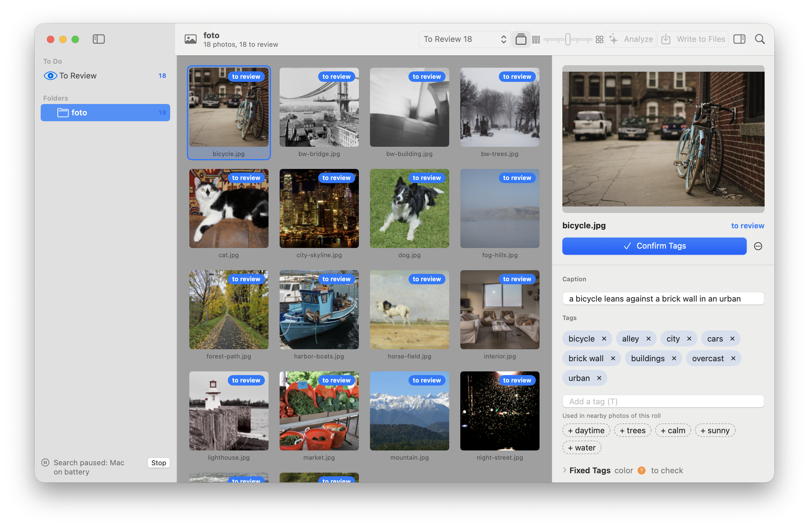
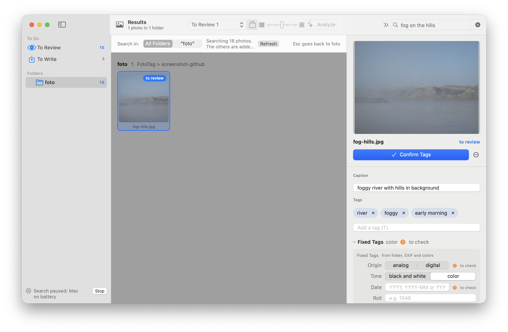
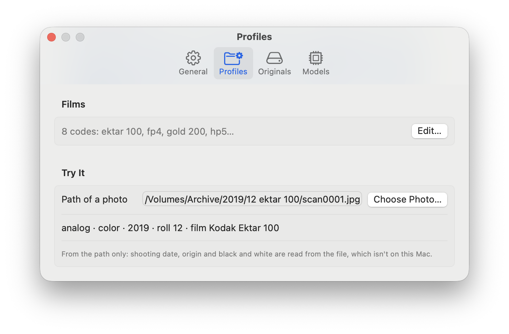

# FotoTag

**English** · [Italiano](README.it.md)

**Keywords and captions for your photos, written on your Mac. Your photos never leave your computer.**

FotoTag looks at the photos in your archive, suggests keywords and a caption, lets you review them, and writes them into the files (or into the `.xmp` sidecar next to RAW files). Then you can search your photos in plain words: "children at the beach", "fog on the hills", "bicycle in the rain".

It is made for photographers with large archives, film scans included, on external drives or in the cloud.

> **Language note:** the app interface and the keywords it writes are in **Italian only** for now. Other languages may come later.



| Search in plain words | Profiles read your folders |
|---|---|
|  |  |

## What it does

- **Runs locally** with a vision-language model (Qwen3-VL, running on Apple silicon through [MLX](https://github.com/ml-explore/mlx-swift)). No online service, no subscription.
- **You have the last word**: suggestions wait in the review list until you confirm them.
- **Writes into files without re-encoding** the image, and keeps a safety copy of every file it touches. RAW files are never modified: keywords go into the `.xmp` sidecar.
- **Searches in plain words** with a second model (SigLIP 2), even among photos you haven't tagged yet.
- **Understands your folders** through profiles: year/month/roll structures, names to ignore, film stock codes ("hp5" → "Ilford HP5 Plus 400").

## Requirements

- A Mac with Apple silicon (M1 or later) and macOS 14 Sonoma or later.
- 16 GB of memory for the standard model (Qwen3-VL 8B, 5.8 GB download); with 8 GB FotoTag uses the light model (4B, 3.1 GB), faster but less accurate.
- About 20 GB of free space: 5 GB to build, 5.8 GB for the analysis model (3.1 GB for the light one), 1.5 GB for the search model, 2 GB that FotoTag always keeps free when downloading a model, plus thumbnails.
- Xcode, free from the Mac App Store.

## Install

There is no ready-made app to download: you build FotoTag from source with a single command. The app is not signed with an Apple certificate, and building it on your own Mac avoids macOS warnings about apps from unidentified developers.

1. Install Xcode and open it once so it finishes installing its components.
2. In Terminal, download the GPU compiler, which Xcode doesn't install by itself:
   ```
   xcodebuild -downloadComponent MetalToolchain
   ```
3. Get the code and build:
   ```
   git clone https://github.com/f-loren/FotoTagMac.git
   cd FotoTagMac
   ./crea_app.sh
   ```
   The first build takes a few minutes. The script puts FotoTag in Applications and opens it. Build files go to `../_build`, next to the source folder; to put them elsewhere: `FOTOTAG_BUILD=/path ./crea_app.sh`.

To update: `git pull`, then `./crea_app.sh` again. If FotoTag is open, the script quits it, and any analysis in progress stops.

## First launch

1. FotoTag asks which folders or drives it may access. Choose the folder that holds your photos: FotoTag sees every subfolder with photos (RAW, HEIC, JPG, TIFF). It analyses JPG, HEIC and TIFF; a RAW file takes its keywords from the JPG of the same shot.
2. macOS may ask for access to Desktop, Documents and Downloads: allow it. This happens again after every build, because the app has no developer signature.
3. Press **Analizza** (Analyse) on a folder. The first time, FotoTag offers to download the right model for your Mac (from Hugging Face, once), then analyses one photo at a time, about 10 seconds each.
4. Check the suggestions in **Da rivedere** (To review), confirm them, and use **Scrivi nei file** (Write to files) when you're ready. Safety copies are kept for 5 days (you can turn this off in Settings).
5. On your first search, FotoTag offers to download the search model (SigLIP 2, 0.75 GB).

## Profiles

A profile tells FotoTag how to read your folder names: whether a folder name becomes a keyword, whether folders follow a year/month/roll structure, which names to ignore ("export", "jpg"…), which ones mean a film scan, and film stock codes. You pick a profile for each drive or folder in Settings ▸ General and edit it in Settings ▸ Profiles, where a test field shows the keywords a given path produces.

The **Generico** (Generic) profile is fine to start with. Profiles can be shared as JSON files (menu "…" ▸ Import and Export): `profili/` contains an example for a film archive organised by year, month and roll.

## Privacy and data

- Your photos are never sent over the network. FotoTag only connects to Hugging Face to download the models, the first time.
- Everything FotoTag stores lives in `~/Library/Application Support/FotoTag/`: database, profiles, models, thumbnails and safety copies.
- Photos stay where they are. FotoTag changes them only through **Scrivi nei file**, after you confirm.

## FAQ

**Why is there no file to download?** Distributing a ready-built app without macOS warnings requires a paid Apple Developer account. Building from source is free and gives you the same app.

**Is it only in Italian?** For now, yes: both the interface and the keywords.

**Does it work with Lightroom, Photomator, darktable?** FotoTag writes keywords and caption into standard metadata (IPTC/XMP), which these programs read. darktable's own `.xmp` files are left untouched.
<!-- DRAFT: verify with a real test in each program before publishing. -->

**Does it run on Intel Macs?** No: MLX requires Apple silicon.

## Contributing

Bug reports and ideas are welcome: see [CONTRIBUTING.md](CONTRIBUTING.md). For security issues see [SECURITY.md](SECURITY.md).

For developers:
- `Sources/FotoTagCore`: analysis (MLX), database, fixed keywords and profiles, file writing, search. `Sources/FotoTag`: the SwiftUI app. `Sources/fototag-cli`: test commands.
- Tests: `swift test --scratch-path ../_build/spm` (needs the Metal Toolchain).
- What the app must do and why: [docs/SPEC.md](docs/SPEC.md) and the decision table in [docs/INTENZIONI.md](docs/INTENZIONI.md) (both in Italian, like the code comments).

## License and credits

FotoTag is free software under the GNU GPL version 3: see [LICENSE.md](LICENSE.md) and the full text in [COPYING](COPYING).

The models (Qwen3-VL by Alibaba Cloud and SigLIP 2 by Google, both Apache 2.0) are not in this repository: FotoTag downloads them from Hugging Face. Third-party libraries and models, with their licenses, are listed in [Risorse/RICONOSCIMENTI.md](Risorse/RICONOSCIMENTI.md).

Sample photos in the screenshots: public domain and CC0 images from Wikimedia Commons, credits in [docs/immagini/CREDITS.md](docs/immagini/CREDITS.md).
